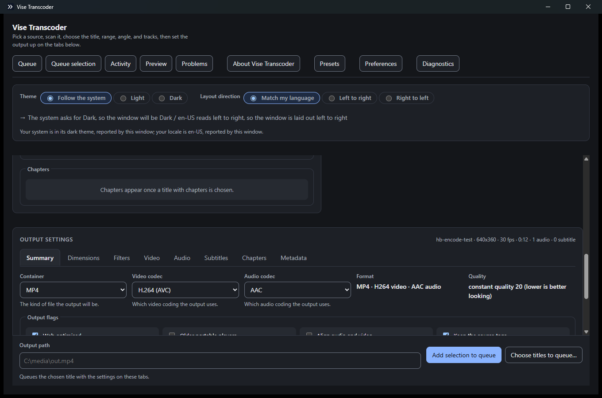
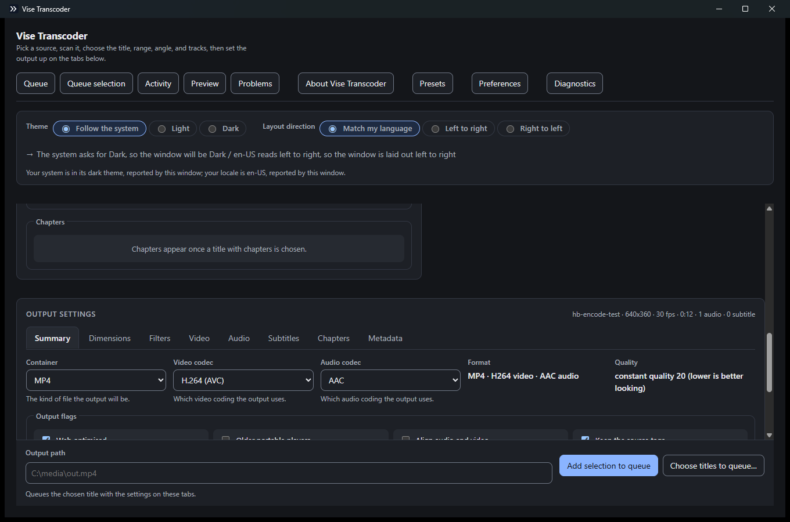
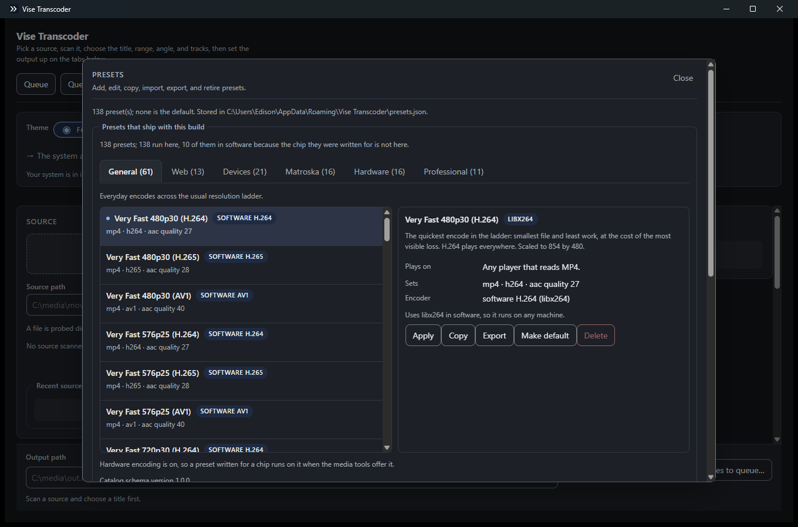

<div align="center">

# Vise Transcoder

**A clean-room media transcoder with a windowed, staged interface.**

[](https://github.com/edisonmalasan/Vise/actions/workflows/release.yml)
[](https://www.rust-lang.org/)
[](https://tauri.app/)
[](LICENSE-MIT)
[](https://github.com/edisonmalasan/Vise/releases)
[](docs/media-tooling.md)

</div>

---

Vise Transcoder converts video and audio between containers and codecs, and gives
you direct control over the result: which title, which range, which tracks, and
every encoder setting.

The window never runs the pipeline inside itself. A separate **worker process**
serves a token-authenticated loopback API, so a long encode never freezes the
interface and an encoder crash costs one job rather than the session.

A shipped build carries **its own pinned copy of ffmpeg**, so the encoders and
filters the application offers are always the ones it was tested against.

## Screenshots

| | |
|---|---|
| <br>**The window.** A source is scanned, the title is chosen, and the action that commits the work is always on screen. | <br>**Eight configuration tabs.** Container, codecs, filters, dimensions, tracks, chapters, and metadata — each control explaining what it does. |
| <br>**138 built-in presets** across six categories, each resolved against the hardware this machine actually has. | |

## Install

Grab a build for your platform from the
[releases page](https://github.com/edisonmalasan/Vise/releases).

| Platform | Artifact | Notes |
|---|---|---|
| **Windows** | `Vise Transcoder_<version>_x64-setup.exe` | NSIS installer, per-user by default |
| **Linux** | `Vise Transcoder_<version>_amd64.deb` | Debian, Ubuntu, and derivatives |
| **Linux** | `Vise Transcoder_<version>_amd64.AppImage` | Runs anywhere, no install |
| **macOS** | `Vise Transcoder_<version>_<arch>.dmg` | Apple silicon and Intel |

Every build carries the media tooling it was tested with. Nothing else needs to
be installed.

## Build from source

You need a [Rust toolchain](https://rustup.rs/) (1.99 or newer) and nothing
else: the interface is plain HTML, CSS, and JavaScript with no build step. The
media tools are fetched and verified for you.

```bash
git clone https://github.com/edisonmalasan/Vise.git
cd Vise

# Fetch and verify the pinned media tools for this platform.
./scripts/fetch-media-tools.sh

# Build the workspace and run the checks.
cargo build --workspace --release
cargo test --workspace
cargo clippy --workspace --all-targets -- -D warnings
cargo fmt --all -- --check
```

Run the desktop application:

```bash
cargo run -p vise-desktop
```

Run the command-line interface:

```bash
cargo run -p vise-cli --bin vise -- --help
```

<details>
<summary>Platform prerequisites</summary>

**Linux** — the desktop window needs a webview toolkit:

```bash
sudo apt-get install -y libwebkit2gtk-4.1-dev libgtk-3-dev \
  libayatana-appindicator3-dev librsvg2-dev build-essential curl file pkg-config
```

**Windows** — Microsoft Visual Studio C++ Build Tools, with the *Desktop
development with C++* workload.

**macOS** — Xcode command line tools: `xcode-select --install`.

</details>

### The Linux package, built in a container

The desktop window links against libraries that a Windows machine cannot
provide, so the Linux package is built in a container rather than
cross-compiled:

```bash
./scripts/build-linux.sh --bundled
```

## How it is put together

| Crate | What it is |
|---|---|
| `crates/vise-core` | The models, the job specification, the encoder invocation, the catalogue, and the localisation. No UI dependency. |
| `crates/vise-ipc` | The shared worker contract, a minimal HTTP/1.1 implementation over `std::net`, the client, and the process supervisor. |
| `crates/vise-worker` | The worker process. It owns the media tooling and answers the JSON API. |
| `crates/vise-cli` | `vise transcode`, `vise batch`, and `vise presets`. |
| `apps/vise-desktop` | The Tauri application: a thin Rust layer over the worker, and a dependency-free HTML/CSS/JS interface with no build step. |

The interesting decisions are written down in the repository:
[`docs/ROADMAP.md`](docs/ROADMAP.md) for what has been built and verified,
[`docs/CONTEXT.md`](docs/CONTEXT.md) for where the truth lives, and
[`docs/media-tooling.md`](docs/media-tooling.md) for how the bundled encoder is
found, pinned, and checked.

## Using the command line

```bash
# One file.
vise transcode --input "C:\media\episode.mkv" --output "C:\media\episode.mp4"

# A list of jobs, one per line.
vise batch --jobs jobs.txt

# The presets that ship with this build.
vise presets list
```

## Contributing

The work is clean-room: no reference source, strings, presets, or assets were
copied. The reverse-engineering notes under `re/` are behavioural and
structural reference only, and are not part of the tracked source.

- [`AGENTS.md`](AGENTS.md) — the working rules
- [`docs/ROADMAP.md`](docs/ROADMAP.md) — the feature roadmap, 187 of 187 outcomes verified

## Licence

Licensed under either of [Apache-2.0](LICENSE-APACHE) or [MIT](LICENSE-MIT), at
your option.

The media tooling a release carries is a separate work with its own licence; see
[`LICENSE-MEDIA-TOOLS`](LICENSE-MEDIA-TOOLS).
